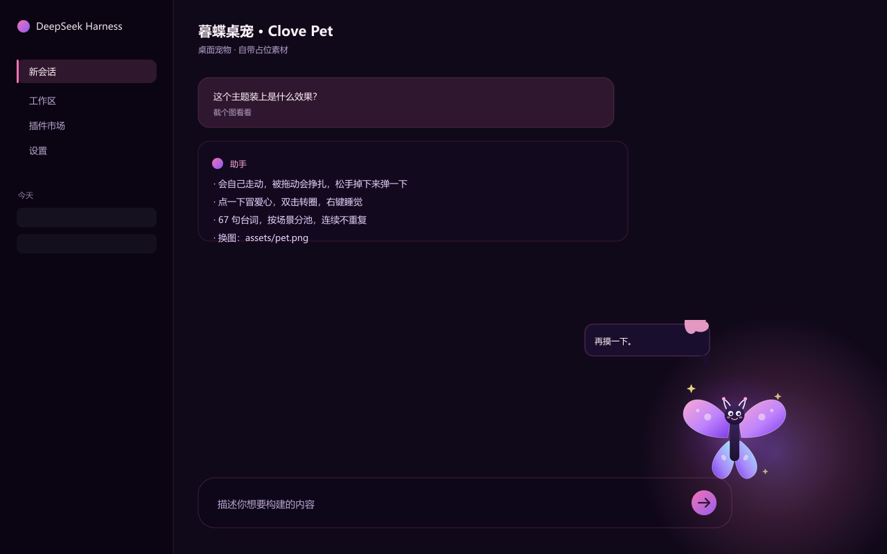

# dsh-pet-clove

DeepSeek Harness Web GUI 的桌面宠物：一只会在屏幕里飞来飞去、能被拖着甩出去、摸头会冒爱心、还会自己睡觉的小家伙。它有自己的小日子：会饿、会渴、会升级，能靠跑任务赚钱买吃的和玩具。

仓库不带同人图，默认用 `assets/default/pet.png`（原创的蝴蝶小精灵）占位；换成自己的图见下面。



## 会做什么

- **日常面板**：点一下小暮蝶打开，再点一下关闭；饥饿度 / 口渴度 / 心情 / 经验条 / 金币一眼看完，面板里还带快捷操作（摸摸 / 飞一下 / 固定 / 睡觉）
- **赚钱**：每天上线自动打卡（+80 起，等级越高越多）；开着页面跑任务，每 10 分钟 +12 金币 **+6 经验**（金币每天上限 240，经验不封顶）
- **商店**：食物、饮品、玩具三栏，金币购买，买完进背包
- **喂养**：状态页里点「吃掉 / 喝掉」，涨饱腹、解渴、加心情；饿了渴了它会自己抱怨
- **玩具**：买的是原创命名的小玩意儿（星光掌机、客厅主机、毛绒蝴蝶、星云投影灯、烟雾拼图），玩具页可以「陪玩」，有冷却时间
- **成长**：喂食、陪玩、签到、买东西都涨经验，升级会加饱腹上限并解锁新台词
- **固定 / 自由**：悬停点 📌 把它钉在原地，再点恢复乱飞；固定状态会记住，刷新页面也不变
- **自由飞行**：未固定时每隔几秒自己挑个位置飞过去，平滑移动带倾斜和拖尾星点；首次出现会从右边飞进来
- **会自己安静**：没人理的时候飞动越来越少，最后自己睡着，不会一直满窗口跑
- **拖动**：按住就能拖，松手带着惯性甩出去，碰到屏幕边缘会弹回来，最后自己停下
- **摸头**：面板里点「摸摸」，它会跳起来冒爱心 + 随机台词，亲密度 +1
- **双击**转一圈，**右键**睡觉/唤醒；睡着时慢慢呼吸冒 `Z`
- **悬停**出现五个按钮：♥ 摸头、✦ 飞一下、📌 固定、📋 面板、☾ 睡觉（面板里也有同样的快捷操作）
- **67 句台词**，按场景分池（问候/摸头/拖拽/独处/深夜…），连续两句不重复
- 漫画尖角气泡，带蝴蝶翼角标，每句随机倾斜，贴屏幕边会自动挪回视口
- 窄屏隐藏；`prefers-reduced-motion` 下关掉装饰动画，但宠物还是会动

## 安装

命令行版（`dsh web`）：

```
dsh plugin --profile web add github:forget6610/dsh-pet-clove
dsh web
```

桌面客户端：到 **设置 → 插件 → 市场** 从 GitHub 源搜索 `dsh-pet-clove` 安装，装完重启客户端。

本地开发：clone 后 `dsh plugin --profile web add link:<路径>`。

装完强刷页面，宠物出现后点一下它就能打开面板，再点一下关闭。

## 数值怎么算

- 饥饿度每 25 分钟 -1，口渴度每 20 分钟 -1，心情每 40 分钟 -1（离线也照算，最多补 12 小时；喂满一次大约能撑一天半以上）
- 经验升级：Lv.2 需要 80 XP，往后每级递增；升级时饱腹和口渴各 +10
- 金币：初始 120；每日签到 80 + 10×(等级-1)；在线任务津贴每 10 分钟 **+12 金币 +6 经验**，金币每天封顶 240
- 所有数据存在 `localStorage`，键名以 `dsh-clove-pet:` 开头，清掉就重新养

## 换角色图

替换 `assets/pet.png`：透明底 PNG、角色大致居中、高 300–500px，底部带一点渐隐更自然。没放就继续用 `assets/default/pet.png`。这个文件在 `.gitignore` 里。

## 调手感

`client.js` 顶部几个常量：

- `MARGIN` 边缘留白（8px）
- `FRICTION` 甩出后的阻尼（2.6，越大停得越快）
- `BOUNCE` 碰边反弹系数（0.55）
- 大小：CSS 变量 `--clove-pet-size`（默认 150px）
- 台词/商品：`LINES`、`SHOP_ITEMS`
- 存档键：`dsh-clove-pet:pos:v2`（位置）、`dsh-clove-pet:affinity:v1`（亲密度）、`dsh-clove-pet:pinned:v1`（固定）、`dsh-clove-pet:care:v1`（养成数据）

## 结构

```
host.js          # 宠物图路由（带默认图回退）
client.js        # 飞行/固定/养成面板/商店/拖动/互动/粒子/台词
assets/default/  # 占位素材（原创）
test/            # 两个零依赖测试
```

## 测试

```
npm test
node test/host-smoke.mjs
```

`npm test` 用手写 DOM stub 跑：挂载、读档、点击开合面板、面板里摸摸、双击、睡觉、飞行动画的 rAF 结束、固定开关、每日签到与数值衰减、面板渲染、买东西/喂食/买玩具/陪玩与冷却、拖动 + 惯性滑行、卸载清理；顺手校验生成的 CSS 不是坏的。

## 许可

代码 MIT。`assets/default/` 的占位图原创，随代码按 MIT 使用。仓库与 Riot Games 无关，也不分发官方或同人素材；商店里的商品名均为原创虚构名称。

---

A small floating desktop pet for the DeepSeek Harness web GUI: it flies around on its own, can be pinned in place, dragged and thrown with inertia, gives hearts when petted, spins on double click, sleeps when ignored, and remembers where it was. It also has a little life: hunger, thirst, mood, XP, coins, a daily sign-in bonus, online "task" earnings, and a shop for food, drinks and toys. 67 lines of dialogue. Ships original placeholder art. MIT. Not affiliated with Riot Games.
